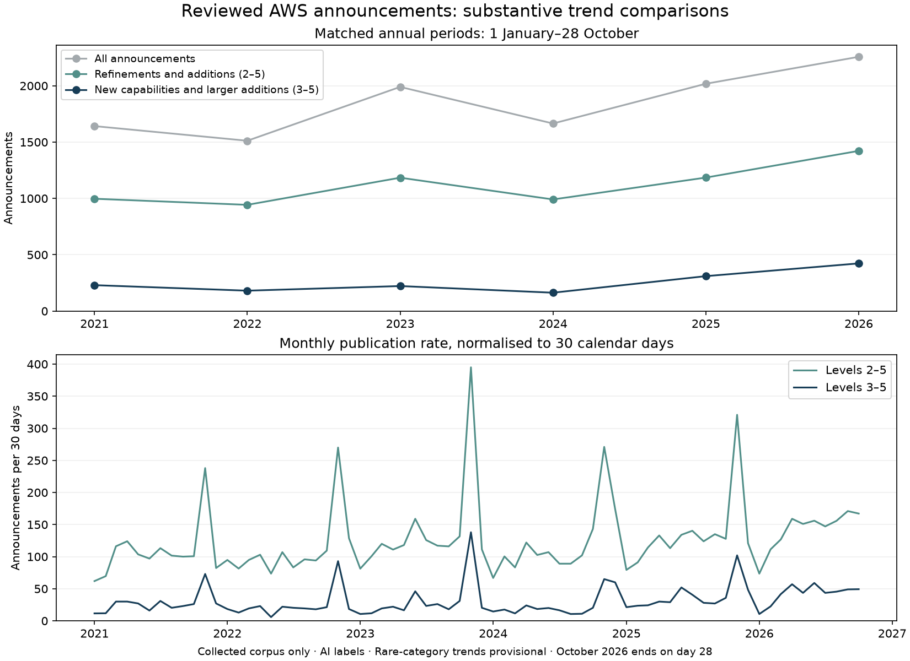

# Substantive AWS announcement trends after review

Calculated on 25 November 2026 from the reviewed release. Comparisons end on 28 October in every year.

The collected data shows substantive announcements growing faster than overall publication volume in 2026. The recent pace of new capabilities and larger additions is broadly flat across consecutive 90-day periods. These are descriptive corpus trends, not estimates of all AWS development activity.

## Definitions used for this analysis

Two thresholds show how the meaning of substantive affects the result. These are analytical groupings of existing labels, not new classifications:

- Broad: levels 2–5, covering capability refinements and larger additions.
- Strict: levels 3–5, covering new capabilities, major expansions, and new products.

Both exclude parameter changes, outside-scale announcements, and unresolved records. Broad includes strict, so the two totals must not be added together. The scale is ordinal; no weighted magnitude score is calculated.

## Annual comparisons over matching dates

All counts cover 1 January–28 October. Year-on-year percentages compare the same grouping with the previous year's count.

| Year | All announcements | Broad: levels 2–5 | Broad YoY | Strict: levels 3–5 | Strict YoY |
| --- | ---: | ---: | ---: | ---: | ---: |
| 2021 | 1,642 | 997 | Not applicable | 230 | Not applicable |
| 2022 | 1,512 | 943 | −5.4% | 181 | −21.3% |
| 2023 | 1,990 | 1,184 | +25.6% | 222 | +22.7% |
| 2024 | 1,665 | 991 | −16.3% | 163 | −26.6% |
| 2025 | 2,018 | 1,185 | +19.6% | 310 | +90.2% |
| 2026 | 2,257 | 1,422 | +20.0% | 423 | +36.5% |

Overall volume grew 11.8% in 2026. Broad substantive share rose from 58.7% to 63.0% of all announcements. Strict substantive share rose from 15.4% to 18.7%.

Parameter changes also grew, from 222 to 312 announcements. Their 40.5% growth is separate from the substantive totals above. Outside-scale announcements fell from 601 to 512. That decline also affects composition shares.

Most of the strict increase comes from level 3: new capabilities rose from 286 to 384 announcements. That increase contributes 98 of the 113 additional strict announcements. The result is not solely an increase in the rare major-expansion or new-product categories.

The historical series fluctuates rather than rising every year. The apparent 2025 increase crosses the boundary between separate historical and recent classification cohorts. Differences in collection coverage and classification can contribute to that change.

Source: [annual counts and calculations](annual_matched.csv). The export also gives rates per 30 calendar days. That adjustment accounts for the extra day in leap years; it does not adjust for publication seasonality.

## Recent velocity

The latest interval is 31 July–28 October 2026. The preceding interval is 2 May–30 July 2026. Both contain 90 calendar days.

| Group | Preceding 90 days | Latest 90 days | Sequential change | Same latest dates in 2025 | Year-on-year change |
| --- | ---: | ---: | ---: | ---: | ---: |
| Broad: levels 2–5 | 448 | 493 | +10.0% | 386 | +27.7% |
| Strict: levels 3–5 | 145 | 144 | −0.7% | 89 | +61.8% |

The latest strict rate is 48 announcements per 30 days. The preceding rate was 48.3. Strict volume is higher than a year earlier, without evidence of further acceleration between these two intervals.

These comparisons are not seasonally adjusted. The [monthly data](monthly.csv) includes actual month lengths and a partial October 2026. The chart reports normalised monthly rates, not forecasts for missing days.

## Unresolved-label sensitivity

Matched periods contain 10 unresolved records in 2025 and 11 in 2026. Assigning every unresolved record adversarially across each threshold gives these growth ranges:

| Group | Observed growth | Lowest growth from unresolved labels | Highest growth from unresolved labels |
| --- | ---: | ---: | ---: |
| Broad: levels 2–5 | +20.0% | +19.0% | +20.9% |
| Strict: levels 3–5 | +36.5% | +32.2% | +40.0% |

For the lower bound, all previous-year unresolved records qualify and none of the current-year records qualify. The upper bound reverses that assignment.

These are sensitivity ranges, not confidence intervals. They exclude classification errors among already assigned labels. The audit agreement percentages cannot be used as simple correction factors for the trend counts.

## Service attribution remains incomplete

Unknown service tags rose from 37 to 257 announcements in the matched periods. Among strict announcements, unknown tags rose from 9 to 86. That increase accounts for 77 of the 113 additional strict announcements.

The overall strict total does not require a service tag. However, attributing its growth to specific services would be premature. Among records with known service tags, strict counts rose from 301 to 337. This 12.0% increase describes a changing subset, not an adjusted estimate of total growth.

The [service comparison export](service_changes.csv) preserves the raw service tags, including aliases and whitespace variants. Tags can overlap, and some describe broad product families. Do not add service totals or treat the largest tag changes as a reliable ranking of product contributions.

## Interpretation and validation limits

The historical audit found 88.5% agreement with an AI-reviewed reference. The separate recent audit found 86.5% agreement in its eligible previously unaudited population. Neither establishes human-validated accuracy or a trend confidence interval.

The historical sample missed two reference major expansions in its initial labels and contained no reference new products. Those sampled errors were corrected. Broader detection of rare categories remains unproven, so their trends remain provisional.

Coverage checks establish consistency with the saved corpus. Historical AWS publication coverage remains unproven. Counts represent announcements, including repeat stages of a feature, rather than unique capabilities or engineering output.

The calculations reconcile directly to the published matched aggregates. Independent DuckDB queries confirm all six annual comparisons and all four 90-day intervals. No classifications were changed for this analysis. See [the release notes](../RELEASE_NOTES.md) for the audit evidence and remaining coverage gaps.
